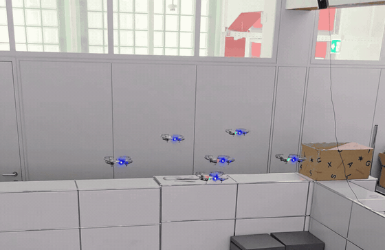
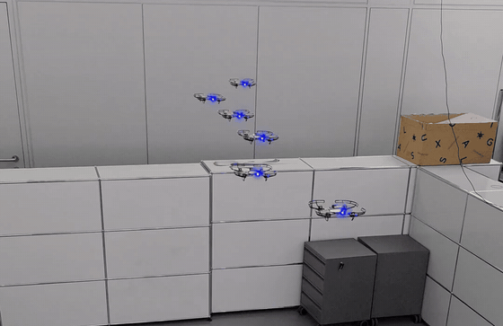
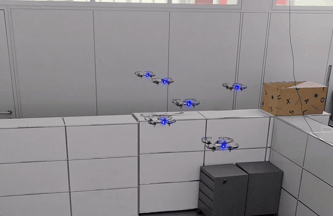
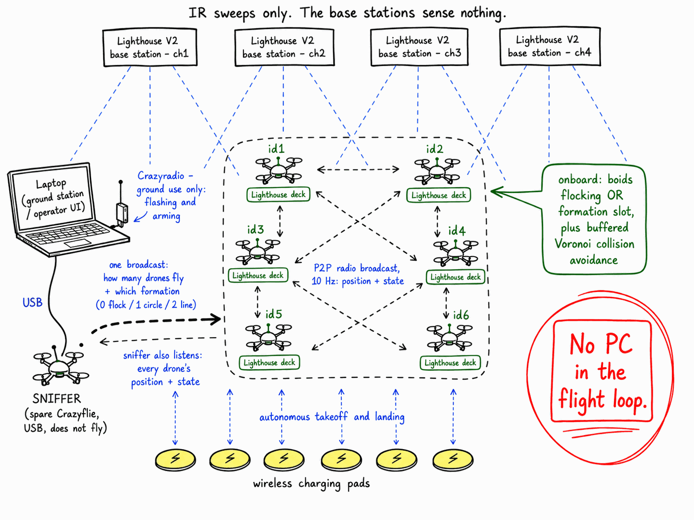

# Crazyflie Decentralized Flocking and Formations

Boids flocking and geometric formations for a swarm of Crazyflie 2.1 Brushless drones, executed entirely onboard. The drones exchange their positions peer to peer over the radio and determine their own targets. No PC participates in the flight loop, no motion capture is required and no waypoints are defined in advance. Positioning is provided by the Bitcraze Lighthouse system. The application is built against `crazyflie-firmware` 2026.08 and runs on top of Bitcraze release 2026.10, including Lighthouse deck bitstream V7.

This work extends Bitcraze's [`decentralized_swarm`](https://www.bitcraze.io/2022/11/the-iros-2022-demo/) example, which supplies the peer to peer swarm, the onboard collision avoidance and the autonomous takeoff and landing on charging pads. The additions in this repository are the flocking behaviour, the geometric formations and a mechanism for switching between them across the entire swarm with a single broadcast.

## Flocking

Each drone derives its steering from the positions of its neighbours using separation, cohesion, bounds and a slow migration drift. The resulting motion is emergent and no drone follows a scripted path.



## Line formation

Each drone determines its rank among the drones currently airborne and occupies the corresponding slot in the shape. In the recording below, six drones hold a line at even spacing.



## Switching formation in flight

A single broadcast from the sniffer changes the formation for the entire swarm simultaneously.



## Execution model



The base stations emit infrared sweeps and sense nothing themselves. Each drone carries a Lighthouse deck, receives those sweeps and computes its own position onboard. The drones then broadcast their position and state to one another over the radio at 10 Hz and each drone derives its own target from the positions of its neighbours.

The sniffer is a spare Crazyflie connected to the ground station over USB. It performs two functions. It broadcasts the number of drones that should be airborne and the formation to be used, in a single message that every drone receives simultaneously. It also listens to the broadcasts from every drone, which is how the swarm is monitored from the ground.

All remaining decisions, including which drone takes off, which drone lands and how the drones avoid one another, are made onboard by the drones themselves. The Crazyradio is used only on the ground, for flashing and for setting parameters before flight. No PC participates in the flight loop.

## Hardware

| Item | Notes |
|---|---|
| [Crazyflie 2.1 Brushless](https://www.bitcraze.io/products/crazyflie-2-1-brushless/) x N | The flying drones. Six were used in this setup. |
| [Lighthouse positioning deck](https://www.bitcraze.io/products/lighthouse-positioning-deck/) x N | One per flying drone. |
| [Lighthouse V2 base stations](https://www.bitcraze.io/documentation/system/positioning/ligthouse-positioning-system/) x 2 to 4 | Two is the minimum. Four provides substantially better coverage. |
| One spare Crazyflie | Runs the sniffer application. It does not fly and does not require a deck. |
| [Crazyradio 2.0 or PA](https://www.bitcraze.io/products/crazyradio-2-0/) | Used for flashing and for setting parameters on the ground. |
| Charging pads (optional) | Required only for autonomous landing and recharging. |

## Setup

### 1. Base stations

Assign each base station a unique channel (1, 2, 3, 4). Connect each station over USB and set its channel using [cfclient](https://github.com/bitcraze/crazyflie-clients-python), following the [getting started with Lighthouse guide](https://www.bitcraze.io/documentation/tutorials/getting-started-with-lighthouse/).

The base stations should be mounted high and angled downwards. Low mounting, for example on shelves, results in poor and inconsistent coverage of the flight volume. Position them so that every part of the arena is visible to at least two stations.

### 2. Estimate the geometry and apply it to every drone

The geometry defines the positions of the base stations. It also establishes the origin of the coordinate system: the position of the Crazyflie used for the estimation becomes (0, 0, 0).

The estimation is performed in [cfclient](https://github.com/bitcraze/crazyflie-clients-python) 2026.8 or later with the geometry setup of its [Lighthouse Positioning tab](https://www.bitcraze.io/documentation/repository/crazyflie-clients-python/master/userguides/userguide_client/lighthouse_tab/), described in the Bitcraze article [A new Lighthouse geometry setup](https://www.bitcraze.io/2026/08/a-new-lighthouse-geometry-setup/). The drone used for the estimation must already run firmware 2026.08 (step 5), because the setup relies on its matched angle stream.

1. Connect to one Crazyflie in cfclient and click **Start set up** in the **Lighthouse Positioning** tab.
2. Take the origin sample with the drone at the intended origin, then the X-axis sample exactly 1.0 m along the intended +X axis, then the XY-plane samples.
3. Take XYZ-space samples across the flight volume by holding the drone still and twisting it quickly at each point.
4. Take three or four verification samples at new points and check that the maximum verification sample error is small, in the order of 10 mm.
5. Wait until the status reads **Uploaded**.

**Every drone in the swarm must receive the same geometry.** The drones reason about one another's positions and therefore require a common coordinate frame. The setup stores the geometry on the connected drone only. Export it with **Export configuration** and write the file to the remaining drones with `firmware/write-geo-all.py`:

```bash
python firmware/write-geo-all.py geometry.yaml
```

If a base station is moved, even slightly, the estimation must be repeated and the geometry rewritten to every drone. A drone whose position wanders by more than a few millimetres while it rests on its pad is the usual sign that the geometry no longer matches the stations.

### 3. Assign a radio address to each drone

The final byte of the radio address serves as the drone's P2P identifier. Assign the addresses `E7E7E7E701`, `E7E7E7E702` and so on, so that the drones take identifiers 1, 2 and upwards. The identifiers must remain in the range 1 to 9. Addresses are assigned in cfclient from the [Connect dialog](https://www.bitcraze.io/documentation/repository/crazyflie-clients-python/master/userguides/userguide_client/), one drone at a time.

The sniffer retains a separate address, for example one ending in `E8`.

### 4. Build the firmware

The build requires the ARM toolchain (`gcc-arm-none-eabi`) and `crazyflie-firmware` at tag 2026.08. The application is built out of tree, with `CRAZYFLIE_BASE` pointing at the firmware tree.

```bash
git clone https://github.com/prakash-aryan/crazyflie-decentralized-flocking.git
git clone --branch 2026.08 --recursive https://github.com/bitcraze/crazyflie-firmware.git
cd crazyflie-decentralized-flocking/firmware
make CRAZYFLIE_BASE=../../crazyflie-firmware BRUSHLESS=1 -j$(nproc)
cp build/cf21bl.bin build/pilot.bin
```

The tree contains two applications, selected in `src/common_files/choose_app.h`. For the sniffer, change `#define BUILD_PILOT_APP` to `#define BUILD_SNIFFER_APP`, run the same `make` command again and copy `build/cf21bl.bin` to `build/sniffer.bin`.

`app-config-brushless` sets `CONFIG_MOTORS_ESC_PROTOCOL_DSHOT` and `CONFIG_MOTORS_REQUIRE_ARMING`, as the Bitcraze `cf21bl_defconfig` does. An out-of-tree build does not read that defconfig. Without the two settings the motors are driven with the OneShot125 protocol and do not respond.

### 5. Flash

Each drone first receives the Bitcraze release bundle, which installs the STM32 firmware, the radio firmware and the Lighthouse deck bitstream V7. The swarm application is then flashed on top. The bundle is needed once per drone; later updates of the application only repeat the second command.

```bash
curl -LO https://github.com/bitcraze/crazyflie-release/releases/download/2026.10/firmware-cf21bl-2026.10.zip
for i in 1 2 3 4 5 6; do
  cfloader -w radio://0/80/2M/E7E7E7E70$i flash firmware-cf21bl-2026.10.zip
  cfloader -w radio://0/80/2M/E7E7E7E70$i flash firmware/build/pilot.bin stm32-fw
done
cfloader -w radio://0/80/2M/E7E7E7E7E8 flash firmware-cf21bl-2026.10.zip
cfloader -w radio://0/80/2M/E7E7E7E7E8 flash firmware/build/sniffer.bin stm32-fw
```

Flashing the sniffer over USB proved unreliable in testing. The radio path is recommended. Reboot every drone once after flashing and check its parameters before the first flight; on rare occasions a drone came up on the factory radio address or without its collision-avoidance box on the first boot after a flash. A reboot corrected both. The Bitcraze command-line client [cfcli](https://github.com/bitcraze/cfcli) works with the drones on this firmware, for example `cfcli -u radio://0/80/2M/E7E7E7E701 platform info`.

If a drone reports that it could not connect to the bootloader, it is generally already in the bootloader. In this case, power cycle the drone during the window opened by `cfloader flash build/pilot.bin stm32-fw` invoked without `-w`, which scans for a drone in bootloader mode and flashes it.

## Flight area and takeoff positions

An incorrectly configured flight area produces a failure mode that closely resembles a hardware fault. This section should be reviewed before the first flight.

The flight area is defined in `firmware/src/common_files/settings.h`:

```c
#define MIN_X_BOUND -0.4f
#define MAX_X_BOUND  1.2f
#define MIN_Y_BOUND -1.8f
#define MAX_Y_BOUND  1.3f
#define MIN_Z_BOUND  0.3f
#define MAX_Z_BOUND  1.6f

#define RANDOM_BOX_MARGIN 0.20f
#define TAKE_OFF_HEIGHT   1.0f
```

With these values the flight box spans x from -0.2 to +1.0 m and y from -1.6 to +1.1 m. The pads lie on a line at x = 0, inside the box, while the flock and the formations are centred at x = +0.4 m, beside the pad line rather than above it. A drone takes off only when no other drone is within 0.5 m horizontally above its pad, so a flock centred over the pads keeps some drones on the ground. The swarm flies at 1.0 m, well below the base stations, because a drone close to the height of the stations receives the sweeps at grazing angles and loses its position.

The flight box is the bounds reduced by `RANDOM_BOX_MARGIN` (0.2 m). The collision avoidance bounding box is derived from that same flight box. Both the flocking targets and the formation slots are clamped to it.

### Constraint on takeoff positions

> **Every takeoff position and therefore every charging pad, must lie inside the flight box.**

A drone whose pad lies outside the box is pinned in place by the collision avoidance layer. It takes off, fails to climb, descends while being commanded upwards and cycles repeatedly between taking off and landing. This behaviour is indistinguishable from a weak motor or a depleted battery, although it is caused by neither. Where a single drone exhibits this behaviour and the remainder operate normally, its pad position should be checked against the flight box before the hardware is suspected.

### Determining the bounds for a given arena

1. Place the drones on their pads and read the position of each one. Any drone fitted with a Lighthouse deck reports `stateEstimate.x`, `stateEstimate.y` and `stateEstimate.z`, either in the client or over cflib.
2. Record the extremes. For example, if the pads span y = -1.57 to y = +1.04, the flight box must cover that entire range.
3. Set the bounds such that the bounds reduced by the 0.2 m margin still contain every pad, with several centimetres in reserve. For the example above, `MIN_Y_BOUND = -1.8` and `MAX_Y_BOUND = 1.3` yield a box from -1.6 to 1.1.
4. Confirm that the box lies within the volume covered by the base stations and within the space that is physically clear at `TAKE_OFF_HEIGHT`. A single drone flown to the far edge of the box before the first swarm flight shows whether the coverage there is sufficient.
5. Rebuild and reflash. These values are resolved at compile time.

A larger flight area is preferable. Drones operating in close proximity contend with the collision avoidance layer and disturb one another through downwash, which is the principal cause of instability and flips.

## Operation

The scripts in `scripts/` require Python 3 and [cflib](https://github.com/bitcraze/crazyflie-lib-python) 0.1.34 or later, the Bitcraze Crazyflie Python library. Further detail is available in the [cflib installation instructions](https://www.bitcraze.io/documentation/repository/crazyflie-lib-python/master/installation/install/).

```bash
cd crazyflie-decentralized-flocking
uv venv
uv pip install cflib
source .venv/bin/activate
```

On Linux, the Crazyradio and the USB connected sniffer are not accessible to a normal user account by default and cflib will fail to open them. Access is granted by adding the current user to the `plugdev` group and installing the Bitcraze udev rules in `/etc/udev/rules.d/`, as described in the [USB permissions guide](https://www.bitcraze.io/documentation/repository/crazyflie-lib-python/master/installation/usb_permissions/). Complete this step before running any of the scripts, otherwise the radio will appear to be absent.

Open `scripts/config.py` and set `DRONE_URIS` to the radio addresses of the drones in use and `SNIFFER_URI` to the sniffer. The defaults correspond to six drones addressed `E7E7E7E701` through `E7E7E7E706`, with the sniffer on `usb://0`.

Connect the Crazyradio and the sniffer, place the drones on their pads and run the scripts from within the `scripts` directory, because they import `config.py` from alongside themselves.

| Step | Command | Effect |
|---|---|---|
| 1 | `python charge_status.py` | Every drone must be at or above 4.0 V and charging to take off |
| 2 | `python arm_swarm.py` | Enables flocking and stores the setting on each drone; needed once after flashing |
| 3 | `python formation_demo.py 6` | Six drones take off, flock, form a circle and a line, flock again and land |
| 4 | `python sniffer_ctl.py 0` | Lands the swarm; this is the stop command |

`formation_demo.py` takes the number of drones to fly as its argument and `sniffer_ctl.py` takes the number that should remain airborne, so `sniffer_ctl.py 0` lands all of them.

`flock.enable` and `flock.form_r` are persistent parameters. `arm_swarm.py` stores them on each drone, so they survive reboots and the arm step is only needed after a fresh flash.

The command `sniffer_ctl.py 0` is issued over the sniffer's USB connection, which remains available even when the radio is saturated. It should therefore be used as the stop command in preference to any mechanism that depends on a radio link established during flight.

After landing, each drone checks whether it is charging. A drone that has missed the charging coil lifts off to about 0.3 m and lands again and repeats this until it charges.

## Tuning

All values below are live parameters and can be changed over the radio without reflashing.

| Parameter | Default | Description |
|---|---|---|
| `flock.enable` | 0 | 0 selects the stock random roaming, 1 selects flocking. Set and stored by `arm_swarm.py`. |
| `flock.sep_w` | 2.0 | Separation weight. Drives drones apart. |
| `flock.coh_w` | 0.8 | Cohesion weight. Draws the flock together. |
| `flock.bnd_w` | 2.5 | Strength with which drones are returned to the flight box. |
| `flock.mig_w` | 0.4 | Migration drift. Keeps the flock in motion rather than settling. |
| `flock.sep_r` | 0.5 | Separation radius, in metres. |
| `flock.coh_r` | 1.2 | Cohesion radius, in metres. |
| `flock.look` | 0.35 | Distance ahead at which the next setpoint is placed. |
| `flock.z` | 1.0 | Flight altitude, in metres. |
| `flock.form_r` | 0.35 | Circle radius, or line spacing. Stored by `arm_swarm.py` as 0.45. |

The formation mode is not a per drone parameter. It is broadcast across the swarm from the sniffer using `app.mode`, so that all drones switch at the same instant.

Two constraints apply when tuning formations. Drones within a formation should be separated by more than approximately 0.4 m, below which the collision avoidance layer begins to contend with the formation and the shape degrades. In addition, the circle radius is limited by the narrowest axis of the flight box, so a wider box yields a more accurate circle.

## Source layout

| File | Contents |
|---|---|
| `src/common_files/flocking.c` | The boids steering and the formation slots. Contains the additions made in this repository. |
| `src/common_files/ds_p2p_interface.c` | The P2P protocol. The formation mode was added to the broadcast message and propagates on a newest-wins basis, in the same manner as the desired flying count. |
| `src/common_files/movement.c` | Waypoints, the landing approach and the check for other drones above the pad, which ignores peer positions older than 400 ms. |
| `src/pilot.c` | The state machine. The roaming state requests its target from `flocking.c` rather than selecting a random point and continues to re-steer while airborne. |
| `src/sniffer.c` | The sniffer application. The `app.mode` parameter was added here to broadcast the formation. |
| `src/common_files/settings.h` | Flight bounds, takeoff height, landing and collision avoidance settings. |

## Adaptation to firmware 2026.08

The application was first written against the 2025 `crazyflie-firmware-experimental` tree and was ported to `crazyflie-firmware` 2026.08. The port required the following changes.

1. `crtpCommanderHighLevelStartTrajectory` takes an additional `relativeYaw` argument and the LED driver `led_control.c` was copied into the application.
2. The out-of-tree configuration sets the DShot motor protocol and required arming (step 4).
3. After an arming request the firmware spins the motors up and checks their speed before it accepts setpoints. Takeoff therefore waits until the supervisor reports that the drone can fly. A drone with a blocked propeller is refused at this point instead of failing in the air.
4. The application enters its crashed state when the supervisor stops the motors in flight.
5. The firmware keeps the last position of every peer indefinitely, whereas the earlier tree dropped it after 400 ms. The application restores the 400 ms limit for its check of drones above the pad. Without it, the frozen positions of landed drones kept some drones from taking off and from retrying a missed landing.
6. A landing ends only when the drone reads within 3 cm of its pad height and the landing trajectory aims 5 cm below the pad. Disarming when the 3 s landing trajectory ended left the drone 10 to 20 cm above the pad, from where it dropped.
7. `flock.enable` and `flock.form_r` are persistent parameters.

## Credits

The peer to peer swarm, the onboard collision avoidance, the charging pad logic and the sniffer concept originate from Bitcraze's `decentralized_swarm` example, first presented as [the IROS 2022 demo](https://www.bitcraze.io/2022/11/the-iros-2022-demo/) and subsequently updated for brushless hardware in the [decentralized brushless swarm demo](https://www.bitcraze.io/2025/03/decentralized-brushless-swarm-demo/). The flocking, the geometric formations and the swarm wide formation broadcast are the contributions of this repository.
